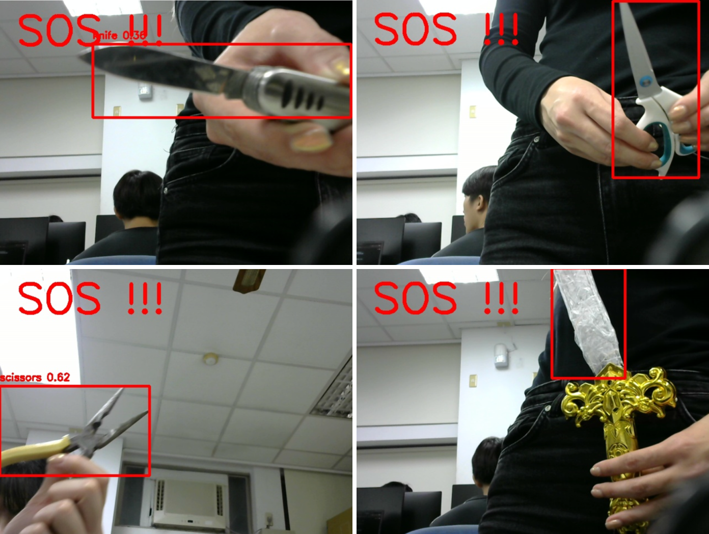

# 危險物品即時警示系統

在 NVIDIA Jetson Nano 上以 YOLOv5 即時偵測刀具與剪刀，偵測到危險物品時透過蜂鳴器與 LED 發出摩斯電碼 SOS（`··· ——— ···`），並在 I2C LCD 上顯示警告訊息。

## 專案動機

近年持刀攻擊事件頻傳，公共場所安全備受關注。本系統透過即時影像辨識偵測危險物品，並以畫面、蜂鳴器、LED、LCD 四種回饋即時發出警示，適用於公共場所、幼兒園等安全需求較高、且可能吵雜或視線不佳的環境。

## Demo

▶ Demo 影片：<https://youtu.be/uQD8-AqvvYM>

## 我的角色

本專案為成功大學工程科學系「網路嵌入式系統應用」課程期末專題（2025，第 19 組，3 人小組）。

我負責軟體設計與實作，包含 YOLOv5 偵測流程、OpenCV 影像處理、GPIO/LCD 警示邏輯與系統整合。

## 技術堆疊

| 元件 | 用途 |
|---|---|
| [PyTorch](https://pytorch.org/) | 深度學習執行環境（Jetson 上使用 CUDA） |
| [YOLOv5](https://github.com/ultralytics/yolov5)（`yolov5s`，v7.0） | COCO 預訓練物件偵測模型，透過 `torch.hub` 載入 |
| [OpenCV](https://opencv.org/) | 攝影機擷取、繪製偵測框、JPEG 編碼 |
| [Jetson.GPIO](https://github.com/NVIDIA/jetson-gpio) | 控制蜂鳴器與 LED |
| [RPLCD](https://github.com/dbrgn/RPLCD) + smbus2 | 透過 I2C 控制 16x2 字元 LCD |
| ipywidgets | 在 Jupyter 中即時顯示影像 |

偵測目標類別（COCO 索引）：`43` = knife（刀子）、`76` = scissors（剪刀）。

## 硬體

- 開發板：NVIDIA Jetson Nano（遠端 JupyterLab 開發環境）
- Webcam
- 蜂鳴器
- LED
- 16x2 LCD（PCF8574 I2C）

## 系統流程

1. **擷取：** OpenCV 從攝影機 0 讀取 640×480 的影像，並由 BGR 轉為 RGB。
2. **偵測：** YOLOv5s 在 GPU 上推論，逐一比對偵測結果是否屬於 `TARGET_CLASSES = [43, 76]`，且信心值大於 `0.1`。
3. **警示：** 偵測到危險物品時，在畫面上標註並更新到 notebook，LCD 顯示警告訊息，`sos()` 同時驅動蜂鳴器與 LED。
4. **恢復：** 冷卻 3 秒後清除 LCD，並丟棄 5 張緩衝畫面，讓下一次推論使用最新影像，接著回到迴圈。